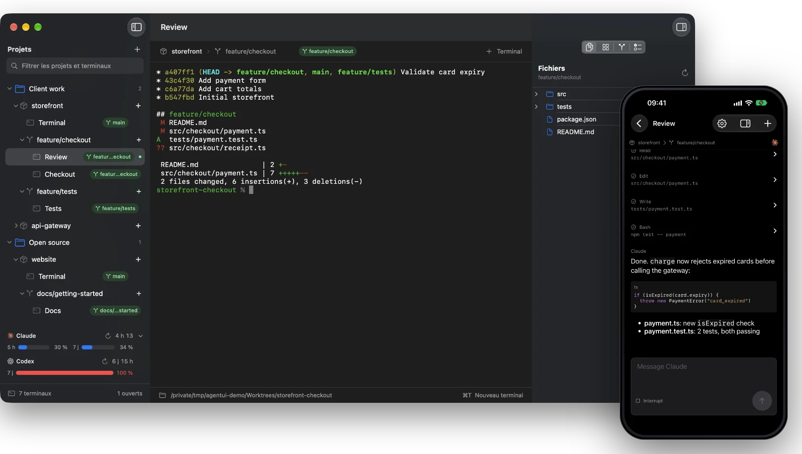

<p align="center">
  
</p>

<h1 align="center">Heka</h1>

<p align="center">
  <b>All your coding agents. One native window.</b><br>
  Projects, Git worktrees and agent terminals organized in one fast, native macOS app.<br>
  Claude, Codex, Copilot, OpenCode: bring the ones you use.
</p>

<p align="center">
  <a href="https://github.com/lebojo/Heka/releases/latest/download/Heka.zip"><b>⬇ Download for macOS</b></a>
  &nbsp;&nbsp;|&nbsp;&nbsp;
  <a href="https://testflight.apple.com/join/DsVPEUqk"><b>📱 TestFlight for iOS</b></a><br>
  <sub>macOS 14+ · Apple silicon &amp; Intel · Signed &amp; notarized &nbsp;—&nbsp; iPhone &amp; iPad, iOS 17+</sub>
</p>

<p align="center">
  <a href="https://github.com/lebojo/Heka/actions/workflows/ci.yml"></a>
  <a href="https://github.com/lebojo/Heka/releases/latest"></a>
  
  
  <a href="LICENSE"></a>
</p>

<p align="center">
  
</p>

## Made for working on many branches at once

<table>
  <tr>
    <td width="50%" align="center" valign="top">
      
      <h3>Every branch in its own worktree</h3>
      <p>Group repositories into folders without moving files. Each branch gets a worktree and its own terminals, and your Claude and Codex limits stay in sight.</p>
    </td>
    <td width="50%" align="center" valign="top">
      
      <h3>Know what each agent changed</h3>
      <p>The inspector follows the terminal you select: its files, Git changes and diffs, pull request and checks.</p>
    </td>
  </tr>
</table>

### Also in your pocket

Follow your agents from your iPhone or iPad while they work on the Mac. Each session shows as a terminal or a clean chat, so you can answer, interrupt or start a new one from the couch. It connects over your local network, encrypted, after you scan a QR code on the Mac. **[Join the beta on TestFlight →](https://testflight.apple.com/join/DsVPEUqk)**

## Say the word

Every Heka terminal comes with the `heka` command. One line from an agent opens a terminal beside it for a review, or starts another agent on its own branch and worktree, then sends it a message, waits for it and reads its reply, while you watch each one appear in the sidebar.

```sh
# Another agent, on its own branch
heka worktree create --branch feature/tests -- codex "Add the tests"

# A second opinion, in the same worktree
heka terminal create --name Review -- claude "Review the changes"

# Wait for it, then read its answer
heka terminal wait --terminal "$REVIEW"
heka terminal read --terminal "$REVIEW" --reply
```

> Heka is named after the [Egyptian god of magic](https://en.wikipedia.org/wiki/Heka_(god)), whose spoken word brought things into being. Here, the word is a command.

Fully native: a SwiftUI sidebar, a native inspector and an AppKit [SwiftTerm](https://github.com/migueldeicaza/SwiftTerm) terminal. No WebView, no Electron. Layout inspired by [Orca](https://github.com/stablyai/orca).

## Features

- **Projects and virtual folders**: group repositories from anywhere on disk without ever moving files.
- **Folder import**: recursive Git repository discovery, idempotent reimport.
- **Git worktrees**: one branch per worktree, created in one click, each with its own terminals.
- **Real terminals**: native PTY, the user's shell, and a branch badge that follows the working directory.
- **Split terminals**: split the current terminal to the right or below, as many times as needed, or drag a terminal from the sidebar (or a pane by its title) onto an edge of another pane of the same worktree.
- **Worktree groups**: gather a project's worktrees under a named group in the sidebar.
- **Inspector**: files, agents, Git changes, diffs, pull/merge request and GitHub Actions or GitLab pipeline checks.
- **`heka` CLI**: agents can create terminals and worktrees from inside their own terminal.
- **Agent usage**: remaining Claude and Codex plan limits, with reset countdowns, below the project list.
- **Persistence**: your organization is restored on relaunch.

## Requirements

- macOS 14 or later
- Xcode 27.1 (Swift 6.4)
- Optional: [`gh`](https://cli.github.com) installed and authenticated (`gh auth login`) for GitHub data in the inspector
- Optional: [`glab`](https://gitlab.com/gitlab-org/cli) installed and authenticated (`glab auth login`) for GitLab data in the inspector

## Download

Download `Heka.zip` from the [latest release](https://github.com/lebojo/Heka/releases/latest), unzip it and move `Heka.app` to `/Applications`. The app is a universal build (Apple silicon and Intel), signed with a Developer ID and notarized by Apple.

For iPhone and iPad (iOS 17+), [join the Heka Mobile beta on TestFlight](https://testflight.apple.com/join/DsVPEUqk). The same link is available in Settings → TestFlight on Mac and iOS. The companion connects to Heka running on your Mac.


To build from source, see [DEVELOPMENT.md](docs/DEVELOPMENT.md).

## Usage

1. Click **+** above the project list to add a repository, or import a whole folder of them.
2. Click **+** next to a project to start a branch in its own worktree, with a terminal ready.
3. Run your agent (`claude`, `codex`, `copilot`, `opencode`…). The inspector on the right shows its files, Git changes, pull request and checks.

| Shortcut | Action |
| --- | --- |
| ⌘T | New terminal in the selected worktree |
| ⌘D / ⇧⌘D | Split right / below |
| ⌘W | Close the selected terminal |

**On iPhone and iPad**: enable **Settings → Accès local** on the Mac, then scan the QR code from the [Heka Mobile beta](https://testflight.apple.com/join/DsVPEUqk) to follow your sessions as a terminal or a chat. Traffic stays on your local network, encrypted.

Everything else (organization, inspector, agent usage, `heka` commands, companion, data and lifetime) is in the **[guide](docs/GUIDE.md)**. Building, tests and contributing are in **[DEVELOPMENT.md](docs/DEVELOPMENT.md)**.

## Current limitations

No scrollback restoration after quitting the app, semantic agent state tracking, or worktree merging or deletion yet.

## License

Heka is dual-licensed:

- **Open source**: [GNU General Public License v3.0](LICENSE). You are free to use, modify and redistribute it, provided that any distributed derivative work is also released under the GPL-3.0 with its source code.
- **Commercial**: if you want to integrate Heka into a proprietary product or distribute it without the GPL obligations, a paid commercial license is available. Contact [contact@jordan-chap.com](mailto:contact@jordan-chap.com).

## Acknowledgements

- [SwiftTerm](https://github.com/migueldeicaza/SwiftTerm) by Miguel de Icaza for the terminal emulator
- [Orca](https://github.com/stablyai/orca) for the reference layout
